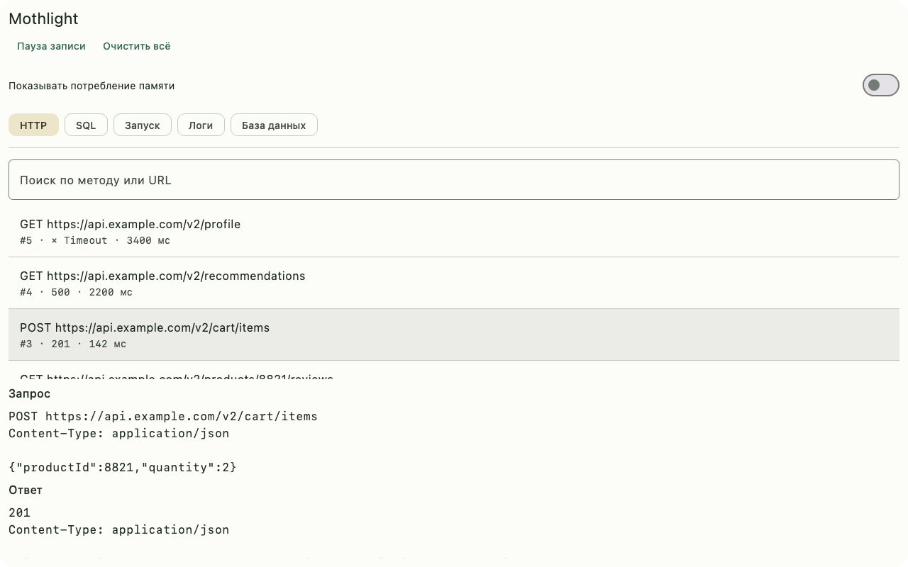
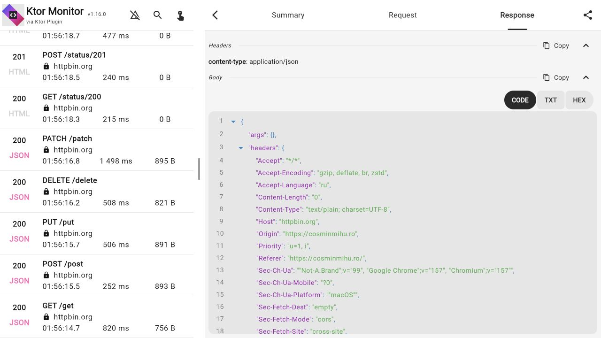

# Сравнение интерфейсов инспекторов и план улучшения Mothlight

**Первыми стоит улучшить общую шапку панели, HTTP и представление таблиц.**
Основная проблема исходного интерфейса Mothlight — распределение места и структура деталей:
широкое окно используется как узкий вертикальный список, а запрос, ответ и cURL
собраны в одну длинную прокрутку. Палитру и декоративные элементы имеет смысл
доводить после этих изменений.

Дата обзора: 7 ноября 2026 года. Все изображения доступны в
[локальной галерее](index.html); нажатие на изображение открывает полный размер.
[Реестр снимков](screenshots.json) содержит источники и размеры.

## Реализованные улучшения

Первый этап уже в текущем коде: компактная шапка, меню настроек, две изменяемые
по ширине колонки HTTP от 840 dp, отдельный экран деталей на узкой панели,
вкладки «Обзор / Запрос / Ответ», быстрые фильтры и локальная очистка HTTP.
JSON доступен как дерево со сворачиванием отдельных объектов/массивов и как
форматированный текст. Копирование URL, cURL, заголовков и тела работает с уже
записанными данными. Состояние просмотра сохраняется между вкладками.

Раздел «После улучшений» в галерее содержит новые снимки; исходные изображения
оставлены для сравнения. Подробности поведения — в [руководстве HTTP](../http-inspector.md).
Второй этап — инспектор логов — также реализован: поиск по сообщениям/тегам,
фильтры уровней и тегов, раскрытие полного сообщения, копирование записи и выборки,
пауза следования и счётчик новых подходящих записей в буфере. Позиция чтения и
фильтры сохраняются между вкладками. В широкой панели управление занимает две строки.
Снимки этапа находятся в разделе «Логи — второй этап» и папке `logs-stage2`;
подробности — в [руководстве логов](../log-inspector.md).
Третий этап — инспектор базы. Появились поиск по таблицам, сетка с закреплённой
шапкой, просмотр полного значения строки и компактная схема. Вкладка данных
подсвечивает изменившиеся ячейки, а «Изменения» показывает предыдущие и новые
значения и строки, которые появились или ушли с текущей страницы.
Новые снимки сняты с Room 3 после вызовов DAO и собраны в разделе «База — третий этап».

Четвёртый этап — SQL и запуск. SQL открывается на сортируемой сводке.
В деталях запроса доступны форматированный SQL, копирование исходного текста
и сохранённые выполнения. Вехи запуска лежат на одной временной шкале.
В разделе «SQL и запуск — четвёртый этап» есть снимки обеих локалей.
Английские строки находятся в `composeResources/values`, русские — в
`composeResources/values-ru`. Для следующего языка добавьте `values-<код языка>`
и используйте те же ключи ресурсов.

Пятый этап — мобильная проверка HTTP, SQL, запуска, логов, данных и схемы.
Все экраны сняты на эмуляторе Android 15 и iPhone 17e Simulator с iOS 26.5
в четырёх сочетаниях темы и локали. Android-демо использует Room 2 и реальные
вызовы DAO. На iOS интерфейс проверен с тестовым источником данных.
В разделе «Мобильная проверка» снимки сгруппированы по платформе, языку и теме.

На узком экране вкладки инспекторов и уровни логов переносятся целиком.
Подписи вкладок HTTP требуют меньше места, а таблица подсказывает, когда
доступна прокрутка по горизонтали. Android-обёртка следует системной теме,
демо учитывает системные отступы, а обе локали включены в APK.

## Что удалось посмотреть

| Проект | Основание сравнения | Ограничение |
| --- | --- | --- |
| KtorMonitor | Работающее web-демо v1.16.0: открыты сводка, ответ и поиск; сделаны три снимка | Проверен конкретный web-интерфейс, не Android/iOS и не последняя опубликованная библиотека |
| KmpInspector | Девять опубликованных автором снимков: широкий и узкий HTTP, JSON, таблицы, SQL, логи и крэши | Библиотека локально не запускалась; снимки из статей автора могут отличаться от текущей версии |
| AELog | Пять оригинальных снимков с официального сайта: сеть, база, логи, аналитика и крэши | Взаимодействие с библиотекой не проверено; сайт содержит изображения интерфейса |
| Inspektify | Снимок браузера с опубликованным автором экраном Overview | Старый снимок из репозитория; не текущий работающий экземпляр |
| Sidekick | Открыто web-демо | Оно осталось на индикаторе загрузки. Снимок сохранён как ограничение проверки, не как пример интерфейса |
| Mothlight | Восемь снимков текущего Compose-интерфейса на синтетических данных | JVM UI-сценарий 1280×800 и 420×860; узкое окно не доказывает поведение на физическом телефоне |

Источники: [демо KtorMonitor](https://cosminmihu.ro/static/apps/ktormonitor/web/),
[обзор KmpInspector](https://mwaqas.dev/blog/kmp-inspector-compose-multiplatform-debugger/),
[база KmpInspector](https://mwaqas.dev/blog/room-database-inspector-kotlin-multiplatform/),
[AELog](https://abdo-essam.github.io/AELog/),
[экран Inspektify](https://github.com/BVantur/inspektify/blob/main/inspektify/screenshots/android_details.png),
[демо Sidekick](https://jipariz.github.io/sidekick/demo/index.html).
Изображения сторонних проектов принадлежат их авторам и собраны для сравнения;
они не являются ресурсами библиотеки Mothlight.

## HTTP

Наш исходный экран до переработки:



Работающее демо KtorMonitor:



На наших снимках общая шапка до разделителя занимает около 208 из 800 пикселей
высоты. Вместе с поиском список начинается примерно на 290-м пикселе. После выбора
запроса оставшаяся высота делится пополам между списком и деталями. На узком экране
видны только начало запроса и начало ответа; для чтения тела приходится прокручивать
внутреннюю область. В списке не выделено состояние выбранного запроса: серый фон на
снимке соответствует взаимодействию, но постоянный выбранный фон в реализации не задан.

У KtorMonitor стоит взять разделение списка и деталей, вкладки Summary/Request/Response,
отдельные секции заголовков и тела, локальные кнопки Copy и сворачивание JSON.
В авторских снимках KmpInspector хорошо работают фильтры Errors/Slow/Writes,
короткий путь в строке, статус с символом и числом, индикатор длительности.
У AELog полезны быстрые All/Success/Errors и счётчики записей. Его раскрытие деталей
прямо в списке выглядит удобным для короткого ответа, но для большого JSON отнимает
контекст соседних запросов; в Mothlight лучше дать деталям самостоятельную область.

Предлагаемая структура:

| Элемент | Решение для Mothlight | Для чего |
| --- | --- | --- |
| Широкая панель | Список слева, детали справа, изменяемый разделитель | Сохранять контекст при чтении ответа |
| Узкая панель | Список → полноразмерные детали → Назад с сохранением прокрутки | Отдать телу ответа всю доступную высоту |
| Строка запроса | Метод, путь, отдельные статус и длительность; host вторым уровнем | Быстро находить сбой без чтения полного URL |
| Выбранная строка | Постоянный фон, контрастная граница и семантика selected | Не терять выбранный запрос среди новых событий |
| Фильтры | Все, HTTP-ошибки, ошибки транспорта, выполняются, медленные; поиск по коду и host | Различать 500, Timeout и незавершённый запрос |
| Детали | Обзор / Запрос / Ответ; выбранная секция сохраняется между запросами | Сравнивать одинаковые части разных вызовов |
| Заголовки | Пары имя/значение с копированием; длинное значение раскрывается | Читать заголовки без текстовой простыни |
| JSON | Форматированный текст и дерево, поиск, сворачивание, копирование значения и пути | Находить вложенные поля |
| Действия | Копировать URL, тело, заголовки, cURL рядом с соответствующей секцией | Не выделять много строк вручную |
| Состояния тела | Отдельно «не записывалось», «превышен лимит», «не JSON» | Не принимать отсутствие захвата за пустой ответ |
| Новые события | Счётчик «ещё N» и явное следование за списком | Не сдвигать читаемый элемент |

Размеры тела, фазы DNS/TLS и протокол не следует рисовать, пока их не предоставляют
модели и адаптеры: сначала нужен корректный сбор. Фильтр «медленные» должен показывать
настраиваемый порог. Для размеров нельзя использовать длину строки как размер
переданного по сети тела. Сравнение запросов должно явно обозначать маскированные
и пропущенные данные.

## Общая оболочка

Собрать название, индикатор записи и действия в одну строку. Настройку оверлея
памяти перенести в меню панели: она сейчас занимает отдельную строку в каждом
инспекторе. Основные вкладки оставить узнаваемыми и доступными с клавиатуры.
При большом количестве инструментов в широком окне можно использовать боковую
навигацию; на узком окне нужен очевидный доступ к скрытым вкладкам.

Сохранить наследование MaterialTheme. Ввести общие правила: обычный шрифт для
названий, моноширинный для JSON/SQL/идентификаторов, выравнивание чисел, согласованные
отступы и одна система выделения. Статус должен различаться текстом/значком и цветом.
Избегать крупных карточек для каждой строки данных. У каждой панели нужны понятные
пустое состояние, ошибка, загрузка и повтор чтения.

Очистку текущего инструмента сделать локальным действием, общую очистку — отдельным
действием с явной областью. Пауза записи и пауза автопрокрутки должны различаться.
Сохранять фильтры, выбранный элемент и прокрутку при переходе между вкладками
в состоянии панели, принадлежащем приложению; скрытые инструменты не должны ради
этого продолжать собирать данные.

## Остальные инспекторы

| Инспектор | Что видно сейчас | Предлагаемое улучшение |
| --- | --- | --- |
| База | Каждая строка — повторяющийся вертикальный список названий и значений. На широком окне трудно сравнить одну колонку в нескольких строках | Список таблиц с поиском; сетка с закреплёнными заголовками, горизонтальной прокруткой и отдельным просмотром длинной ячейки. На узком экране оставить режим карточек. Явно различать NULL, пустую строку, скрытое значение и BLOB |
| Схема | Крупная карточка на каждую колонку | В широком окне компактная таблица Имя / Тип / NOT NULL / PK / Вид; карточки оставить для узкого окна. Добавить индексы и внешние ключи отдельными секциями после появления соответствующих метаданных |
| SQL | Повторы занимают отдельные полноширинные строки; ошибка видна, но общий вклад запроса приходится искать во вкладке статистики | Начальная сводка со столбцами Запрос / Выполнений / Всего мс / Последний мс / Ошибок; сортировка по стоимости и переход к конкретным выполнениям. В деталях — форматированный SQL и копирование. Не называть текущую длительность CPU-временем |
| Логи | Нет поиска и фильтров уровней/тегов; время выводится числом миллисекунд | Поиск, уровни с текстом/значком, фильтр по тегу, читаемое время с возможностью увидеть исходное значение, пауза следования, копирование строки и отфильтрованных записей |
| Запуск | Временные интервалы представлены отдельными полосками без общей оси | Единая ось времени, начало каждого интервала на его фактическом смещении, подписи длительностей и выбор этапа; последнюю метку показывать маркером, а не завершённой операцией |
| Память | В этом наборе нет отдельного снимка оверлея | Сначала проверить реальный оверлей. Далее рассмотреть историю, диапазон и поддержку метрик по платформам. Не обещать поиск утечек по одному росту RSS |

В снимках KmpInspector таблица гораздо удобнее для сравнения колонок, чем наш
нынешний текстовый вывод. При этом длинные значения в сетке обрезаются: отдельный
просмотр ячейки должен оставаться доступным. Для Mothlight важно сохранить живое
обновление и не сбрасывать позицию при каждом invalidation; если читаемая строка
исчезла, это должно быть видно.

## Порядок реализации

1. **Оболочка и HTTP.** Компактная шапка, адаптивный список/детали, выбранная строка,
   вкладки деталей, фильтры, кнопки копирования. Это даёт наибольшую ежедневную пользу.
2. **JSON и логи.** Общие компоненты поиска и технического текста, дерево JSON,
   фильтры уровней/тегов, сохранение контекста чтения.
3. **База и схема.** Сетка, длинная ячейка, выбор таблицы, компактные метаданные.
4. **SQL и запуск.** Сортируемая сводка SQL, детали выполнений, единая временная ось.
5. **Визуальная доводка.** Тёмная/светлая тема, длинные русские подписи, клавиатура,
   большой шрифт, реальные Android/iOS-экраны и разные положения дока.

Критерий готовности первого этапа: в окне 1280×800 список и тело ответа читаются
рядом; в окне 420×860 детали получают всю рабочую область. После открытия второго
запроса остаётся выбранной вкладка «Ответ», а возврат восстанавливает позицию списка.
HTTP 500 и Timeout можно найти разными фильтрами. URL, тело и cURL копируются отдельными
действиями с сохранением существующего маскирования. Автоматические проверки должны
покрывать эти сценарии, очистку выбранного запроса и поступление новых событий во
время чтения.

Это предложения по наблюдаемым проблемам, а не доказательство превосходства
будущего интерфейса. Сравнение скорости выполнения задач ещё нужно провести на
одинаковых данных в работающих приложениях.

## Воспроизведение наших снимков

```shell
./gradlew :sample-desktop:test --tests '*InspectorReviewScreenshotsTest'
```

Сценарий лежит в `sample-desktop/src/test`, результаты — в
`sample-desktop/build/reports/inspector-review`. Снимки в этой папке — сохранённый
набор для обзора, а не автоматически обновляемые эталоны. Исходный набор находится
в `screenshots`, снимки после первого этапа переработки — в `after`.
